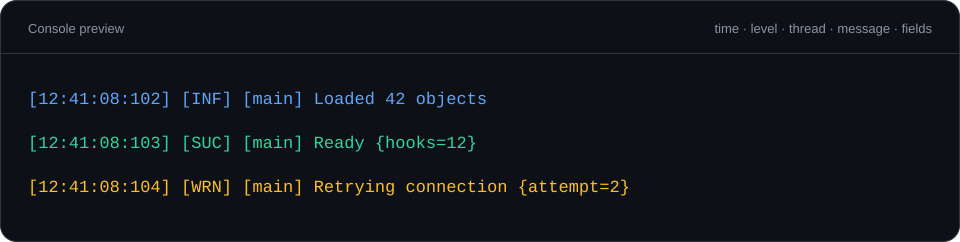
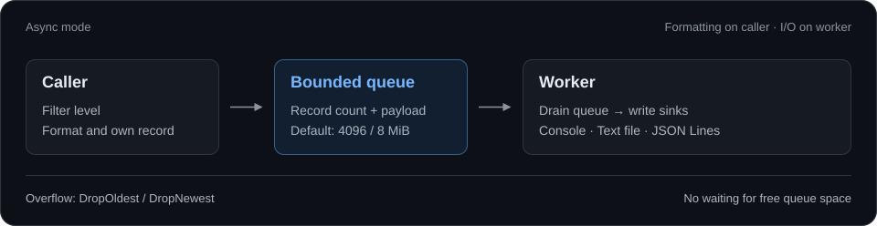

# logger

A header-only C++23 logger for Windows and MSVC. Console output, rotating files
and JSON Lines, with synchronous or bounded asynchronous delivery.

[Quick start](#quick-start) · [Sinks](#sinks) · [Async mode](#async-mode) · [Guide](docs/guide.md)



## Quick start

Add `logger/src` to your include directories and enable C++23, `/EHsc` and
`/utf-8`. Include the public header; there are no library sources to compile.
[CMake setup →](docs/guide.md#integration)

```cpp
#include <logger/logger.h>

log::Result initialize_logging() { // Call outside DllMain.
    log::ConsoleConfig console;
    console.show_date = false;
    console.show_file = false;
    if (auto result = log::init_console(console); !result)
        return result;

    log::set_thread_name("main");
    log::info("Loaded {} objects", 42);
    log::success({{"hooks", 12}}, "Ready");
    log::warn({{"attempt", 2}}, "Retrying connection");
    return {};
}
```

This produces the layout shown above. The example hides the date and source
location; both are enabled by default.

The default is **synchronous**: each call writes and flushes its record. Sinks are
added explicitly. `init_console()` can allocate a console if the process has none;
an existing host console keeps its settings by default.

## Sinks

Combine sinks on the same logger. Each can have its own level threshold.

| Output | Add with | Defaults |
| --- | --- | --- |
| Console | `log::init_console(config)` | Colors, time, source and thread name |
| Text file | `log::add_file_sink(path, max_size, max_files)` | Rotate at 5 MiB, keep 1 backup |
| JSON Lines | `log::add_json_sink(path, max_size, max_files)` | Rotate at 10 MiB, keep 3 backups |

For example, add both file outputs during initialization:

```cpp
log::Result add_files() {
    if (auto result = log::add_file_sink("logs/module.log"); !result)
        return result;
    return log::add_json_sink("logs/module.jsonl");
}
```

Use a path specific to your module. Relative paths resolve against the host
process working directory. JSON preserves field types under a `fields` object
and uses UTC timestamps. [Console options, rotation and custom sinks →](docs/guide.md#sinks)

## Levels and filtering

`Trace < Debug < Info < Success < Warn < Error < Critical < Off`

Set the threshold with `log::set_level(log::Level::Debug)`. All seven logging
functions accept either a format string and arguments, or fields followed by a
format string and arguments. Format strings are checked at compile time.

For expensive arguments, use the `LOG_*` macros. They check the runtime level
before evaluating arguments; `LOG_ACTIVE_LEVEL` also removes lower levels at
compile time.

```cpp
#define LOG_ACTIVE_LEVEL ::log::Level::Info
#include <logger/logger.h>

std::string build_diagnostics();

void report_frame(int frame) {
    LOG_DEBUG("Frame details: {}", build_diagnostics()); // Compiled out.
    LOG_INFO({{"frame", frame}}, "Rendered");
}
```

Ordinary `log::debug(...)` calls filter formatting, but C++ still evaluates their
arguments. Use `log::lazy()` for deferred message creation, or `log::text()` for
runtime text with literal braces. [Filtering examples →](docs/guide.md#filtering)

## Async mode

Choose async when callers should hand off sink I/O to a worker. Formatting still
happens on the calling thread.



```cpp
log::Result configure_async() { // Before the first log call.
    log::Config config;
    config.mode = log::Mode::Asynchronous;
    config.queue_capacity = 4096;
    config.max_queue_bytes = 8 * 1024 * 1024;
    config.overflow = log::OverflowPolicy::DropOldest;
    return log::configure(config);
}
```

The worker starts on demand. A full queue drops records according to
`DropOldest` or `DropNewest`; producers never wait for free queue space.
**Any level can be dropped**, including Error and Critical. Check
`log::statistics()` and `log::last_error()` to monitor delivery.

`log::flush()` waits for prior accepted records to be processed or counted as
dropped, then flushes the sinks. [Queue limits and delivery guarantees →](docs/guide.md#queue-and-delivery)

## Using it in a DLL

1. Initialize outside `DllMain` and global constructors.
2. Stop hooks and other producers before unloading the DLL.
3. In async mode, call `log::shutdown()` **outside `DllMain`, before unload**.
   It drains the queue, flushes and destroys the sinks. Shutdown is terminal.

Synchronous mode needs no worker join. Normal CRT cleanup closes the sinks and
releases a console allocated by the logger.

A manual mapper must initialize the C++ runtime, TLS and exception/unwind support,
and run module cleanup. Calling only `DllMain` is insufficient. LoadLibrary
unload paths are tested; manual mapping has not been tested with a specific mapper.
[Lifetime contract →](docs/guide.md#dll-lifetime)

## Build and checks

The CMake `logger` target is an INTERFACE library. The local test runner uses
Visual Studio 2026 Build Tools; the verified compiler is MSVC 19.51 / v145 in
C++23 preview mode.

```powershell
./tests/run.ps1 -Configuration Debug
./tests/run.ps1 -Configuration Release
```

[Verification matrix and benchmark results](benchmarks/README.md) ·
[All test commands](docs/guide.md#verification) ·
[Migration notes](docs/guide.md#migration)
